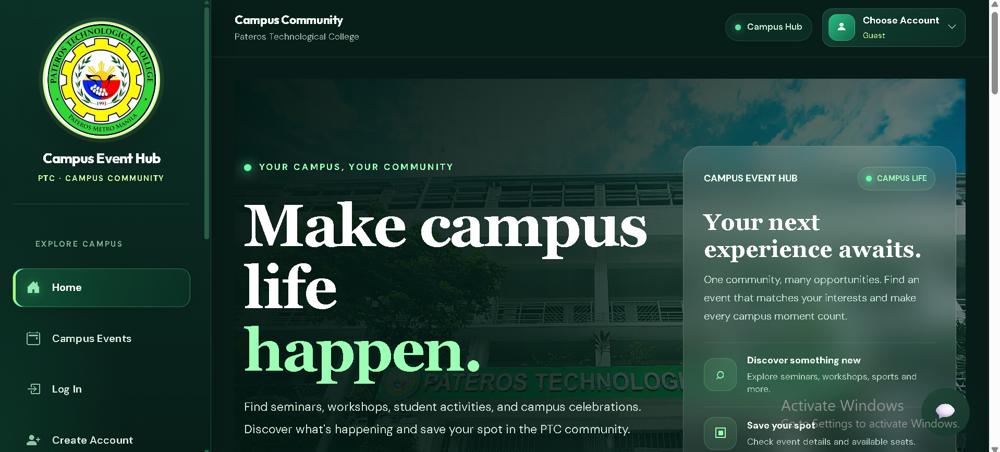
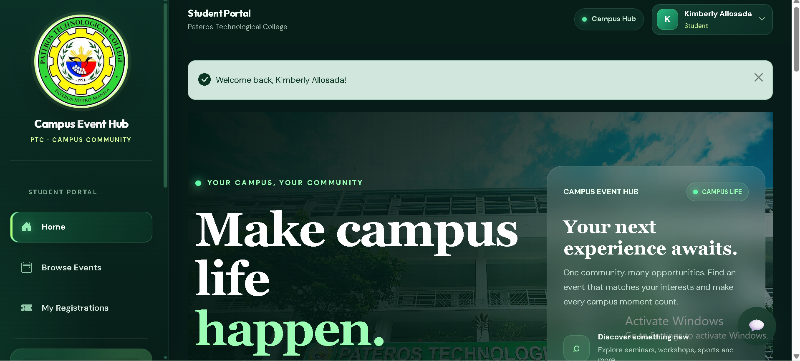
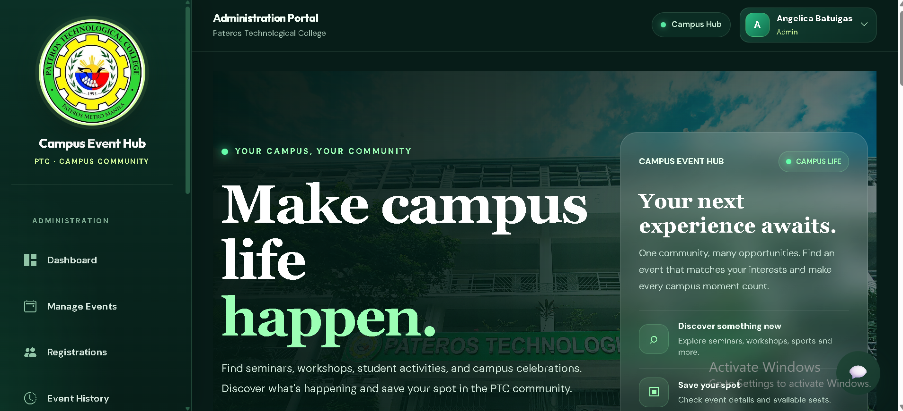

# Campus Event Hub

Campus Event Hub is a web-based campus event management system developed using PHP 8+, MySQL or MariaDB, HTML, CSS, JavaScript, and Bootstrap 5.

The system allows students to explore campus events, register for activities, and manage their event registrations. Administrators can create and manage events, monitor student registrations, and maintain event records.

## Homepage Preview

The following screenshots show the different homepage views of Campus Event Hub based on user roles.

### 1. Guest Homepage

Guests can explore available campus events and view event information without logging in.



### 2. Student Homepage

Students can browse campus events, register for activities, and access their personal event information.



### 3. Administrator Homepage

Administrators can access the dashboard, manage campus events, monitor registrations, and maintain event records.



---

## Features

### Guest Features
- Browse available campus events without logging in.
- View event details.
- Explore event categories and information.
- Access the login and registration pages.

### Student Features
- Student account registration, login, and logout.
- Secure password hashing and session management.
- Browse available campus events.
- Search events using keywords.
- Filter events by category.
- View event details, including date, time, venue, organizer, and available slots.
- Register for available events.
- Prevent duplicate event registrations.
- Validate event capacity to prevent overbooking.
- View personal registration history.
- Cancel eligible event registrations.

### Administrator Features
- Administrator dashboard.
- Create and manage campus events.
- Edit event information.
- View event registrations and attendee lists.
- Monitor event capacity.
- Archive and restore events.
- View event history.
- Monitor student participation.

### System Features
- Responsive design for desktop and mobile devices.
- PDO prepared statements.
- Server-side input validation.
- HTML output escaping.
- CSRF protection.
- Role-based access control.
- Green-themed user interface.

## Technologies Used

| Component | Technology |
|---|---|
| Backend | PHP 8+ |
| Database | MySQL / MariaDB |
| Frontend | HTML5, CSS3, JavaScript |
| UI Framework | Bootstrap 5 |
| Local Development | XAMPP |
| Database Management | phpMyAdmin |
| Code Editor | Visual Studio Code |

## System Requirements

Before running the application, make sure you have:

- Windows, Linux, or another supported operating system.
- XAMPP or another PHP development environment.
- PHP 8 or later.
- MySQL or MariaDB.
- A modern web browser.
- Visual Studio Code or another code editor.

## Installation and Setup

### Step 1: Install XAMPP

Download and install XAMPP if it is not yet installed.

Open the XAMPP Control Panel and start:

- Apache
- MySQL

### Step 2: Place the Project Folder

Copy or extract the project into the XAMPP `htdocs` directory.

Expected project location:

```text
C:\xampp\htdocs\campus-event-hub
```

### Step 3: Create the Database

Open phpMyAdmin:

[http://localhost/phpmyadmin/](http://localhost/phpmyadmin/)

Import the SQL file located at:

```text
database/campus_event_hub.sql
```

The SQL file contains the database structure for the Campus Event Hub system.

After importing, verify that the `campus_event_hub` database and its required tables have been created.

**Important:** Back up any existing database before importing SQL or changing its structure. The SQL file provides the database schema; it does not automatically populate the database with sample student accounts or event records.

### Step 4: Configure the Database Connection

Open this file in Visual Studio Code:

```text
config/database.php
```

The default local XAMPP configuration may use:

- Host: `localhost`
- Database: `campus_event_hub`
- Username: `root`
- Password: Empty

The application also supports database settings through environment variables:

- `DB_HOST`
- `DB_NAME`
- `DB_USER`
- `DB_PASS`

Use the actual database credentials configured on your computer.

### Step 5: Run the Application

Open your browser and visit:

[http://localhost/campus-event-hub/](http://localhost/campus-event-hub/)

The homepage should display the available campus events.

### Step 6: Register a Student Account

1. Open the application.
2. Click **Register** or **Create Account**.
3. Enter the required information.
4. Submit the registration form.
5. Log in using your registered account.

### Step 7: Create an Administrator Account

Register a normal account first.

Open phpMyAdmin and select the `campus_event_hub` database.

Run the following SQL query, replacing `YOUR_REGISTERED_USERNAME` with the actual username of the account you want to promote:

```sql
UPDATE users
SET role = 'admin'
WHERE username = 'YOUR_REGISTERED_USERNAME';
```

Log out and log in again to refresh the account session.

**Security Reminder:** Public registration should not allow users to select the administrator role. Administrator access must only be granted to authorized personnel.

## Main Project Structure

```text
campus-event-hub/
│
├── admin/
│   ├── add-event.php
│   ├── cancel-event.php
│   ├── dashboard.php
│   ├── edit-event.php
│   ├── event-history.php
│   ├── manage-events.php
│   ├── registrations.php
│   └── restore event.php
│
├── assets/
│   ├── css/
│   │   └── style.css
│   ├── js/
│   │   └── script.js
│   └── images/
│       ├── homepage-guest.png
│       ├── homepage-student.png
│       └── homepage-admin.png
│
├── config/
│   └── database.php
│
├── database/
│   └── campus_event_hub.sql
│
├── includes/
│   ├── auth.php
│   ├── chatbot-widget.php
│   ├── footer.php
│   └── header.php
│
├── cancel-registration.php
├── chatbot.php
├── event-details.php
├── events.php
├── index.php
├── login.php
├── logout.php
├── my-registrations.php
├── register-event.php
├── register.php
├── ticket.php
└── README.md
```

*Note: The project may contain additional files or folders depending on the current development version.*

## User Roles

### Guest

Guests can:

- Browse available campus events.
- View event information.
- Explore the homepage without logging in.
- Access login and registration pages.

### Student

Students can:

- Create an account and log in.
- Browse and search campus events.
- View event information.
- Register for available events.
- View personal registration history.
- Cancel eligible registrations.

### Administrator

Administrators can:

- Access the administrator dashboard.
- Create and edit campus events.
- Manage event records.
- Archive and restore events.
- View student registrations.
- Monitor attendee information and event capacity.
- Review event history.

## Security Features

The application uses security practices intended to help protect user accounts and system data:

- **Password Hashing:** PHP password-hashing functions are used to protect stored passwords.
- **Prepared Statements:** PDO prepared statements help prevent SQL injection.
- **Input Validation:** User input is validated on the server.
- **Output Escaping:** Dynamic HTML output is escaped to help prevent cross-site scripting (XSS).
- **CSRF Protection:** Forms that modify data use CSRF token validation.
- **Role-Based Access Control:** User permissions are checked on the server.
- **Session Management:** Sessions are handled during login and logout.

These protections depend on their correct implementation in the application code.

## Testing Checklist

Before submitting or deploying the application, test the following:

1. The homepage displays available campus events.
2. Guests can browse public event information.
3. Students can register for an account.
4. Valid login credentials allow access to the system.
5. Invalid login credentials display an appropriate error message.
6. Students can browse and search events.
7. Event details display the correct information.
8. Students can register for available events.
9. Duplicate registrations are prevented.
10. Registration is rejected when an event is full.
11. Registration is rejected when an event is closed or unavailable.
12. Students can view their registration history.
13. Students can cancel eligible registrations.
14. Administrators can create and edit events.
15. Administrators can view event attendees.
16. Students and guests cannot directly access administrator-only pages.
17. Database records remain saved after refreshing the browser.
18. The application works on desktop and mobile devices.

## Troubleshooting

### Database Connection Error

- Make sure MySQL is running in XAMPP.
- Check the settings in `config/database.php`.
- Verify that the `campus_event_hub` database exists.
- Confirm that the database username and password are correct.

### Page Not Found

- Make sure the project folder is inside `C:\xampp\htdocs\`.
- Verify that the folder name is `campus-event-hub`.
- Check the requested PHP filename.
- Confirm that Apache is running.

### Unknown Column or Missing Table

- Check whether the required table or column exists in phpMyAdmin.
- Compare the database structure with the SQL queries used in the PHP files.
- Back up the database before applying schema changes.

### Login or Registration Problems

- Check the PHP error logs.
- Verify that the database connection works.
- Confirm that the required user columns exist.
- Make sure passwords are hashed during registration and verified during login.

## Before Deployment

Before hosting the application online:

- Configure database credentials using environment variables or protected server configuration.
- Enable HTTPS.
- Disable public error display and configure secure error logging.
- Back up the database regularly.
- Test authentication, registration, cancellation, and administrator permissions.
- Never publish database credentials or real user passwords on GitHub.
- Update `APP_BASE_URL` in `includes/auth.php` if the application is hosted at a different path.
- Use a hosting provider that supports PHP and MySQL or MariaDB.

**Important:** GitHub Pages does not execute PHP. A PHP-compatible hosting service is required to run this application.

## Project Purpose

Campus Event Hub aims to provide a convenient platform for students to discover campus activities and manage their event registrations. It also helps administrators organize events, monitor participation, and manage event information in one centralized system.

## License

This project is intended for educational and academic purposes. Add a specific open-source license if you plan to distribute or publish the source code publicly.